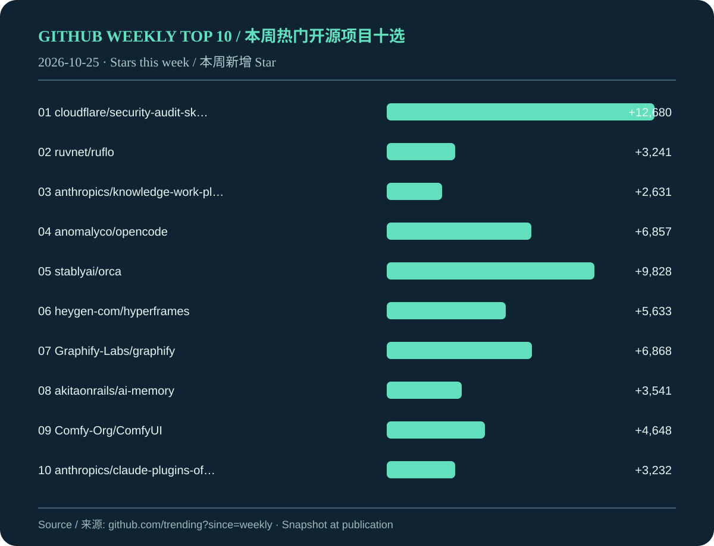

# GitHub 本周热门开源项目十选 / GitHub Weekly Open Source Top 10 — 2026-10-25

**抓取时间 / Captured:** 2026-10-25 23:29 Asia/Shanghai  
**来源 / Source:** [GitHub Trending — This week](https://github.com/trending?since=weekly)

按 GitHub Trending 页面顺序选取，Star 数据为抓取时快照。双语简介按需使用离线机器翻译，请以原项目说明为准。  
Selected in GitHub Trending page order. Star counts are a capture-time snapshot. Bilingual summaries use offline machine translation where needed; refer to the original repositories for authoritative descriptions.

| 排名 / Rank | 项目 / Repository | 本周新增 Star / Stars this week | 主要语言 / Language |
| ---: | --- | ---: | --- |
| 1 | [cloudflare/security-audit-skill](https://github.com/cloudflare/security-audit-skill) | +12,680 | JavaScript |
| 2 | [ruvnet/ruflo](https://github.com/ruvnet/ruflo) | +3,241 | TypeScript |
| 3 | [anthropics/knowledge-work-plugins](https://github.com/anthropics/knowledge-work-plugins) | +2,631 | Python |
| 4 | [anomalyco/opencode](https://github.com/anomalyco/opencode) | +6,857 | TypeScript |
| 5 | [stablyai/orca](https://github.com/stablyai/orca) | +9,828 | TypeScript |
| 6 | [heygen-com/hyperframes](https://github.com/heygen-com/hyperframes) | +5,633 | TypeScript |
| 7 | [Graphify-Labs/graphify](https://github.com/Graphify-Labs/graphify) | +6,868 | Python |
| 8 | [akitaonrails/ai-memory](https://github.com/akitaonrails/ai-memory) | +3,541 | Rust |
| 9 | [Comfy-Org/ComfyUI](https://github.com/Comfy-Org/ComfyUI) | +4,648 | Python |
| 10 | [anthropics/claude-plugins-official](https://github.com/anthropics/claude-plugins-official) | +3,232 | Python |

## 1. [cloudflare/security-audit-skill](https://github.com/cloudflare/security-audit-skill)

**中文简介：** 多阶段安全审计的编码代理技能,并有经独立核实、机器可读的结论

**English description:** A coding-agent skill for multi-phase security audits with independently verified, machine-readable findings

**数据 / Facts:** JavaScript · MIT · 本周新增 / Weekly +12,680 ⭐ · 累计 / Total 46,162 ⭐

## 2. [ruvnet/ruflo](https://github.com/ruvnet/ruflo)

**中文简介：** \{\\fn黑体\\fs22\\bord1\\shad0\\3aHBE\\4aH00\\fscx67\\fscy66\\2cHFFFFFF\\3cH808080\}原始的特工绳索 部署智能多玩家群,协调自主工作流程,并构建对话AI系统. 特点有适应性记忆、自学智能、联邦、矢量RAG集成、本地Claude Code/Codex/Hermes和许多其他集成

**English description:** 🌊 The original agent harness. Deploy intelligent multi-player swarms, coordinate autonomous workflows, and build conversational AI systems. Features adaptive memory, self-learning intelligence, federation, vector RAG integration, and native Claude Code / Codex / Hermes and many more Integrated

**数据 / Facts:** TypeScript · MIT · 本周新增 / Weekly +3,241 ⭐ · 累计 / Total 79,198 ⭐

## 3. [anthropics/knowledge-work-plugins](https://github.com/anthropics/knowledge-work-plugins)

**中文简介：** 主要供知识工作者在克洛德合作中使用的插件的开源存储器

**English description:** Open source repository of plugins primarily intended for knowledge workers to use in Claude Cowork

**数据 / Facts:** Python · Apache-2.0 · 本周新增 / Weekly +2,631 ⭐ · 累计 / Total 32,877 ⭐

## 4. [anomalyco/opencode](https://github.com/anomalyco/opencode)

**中文简介：** 开源编码代理.

**English description:** The open source coding agent.

**数据 / Facts:** TypeScript · MIT · 本周新增 / Weekly +6,857 ⭐ · 累计 / Total 221,420 ⭐

## 5. [stablyai/orca](https://github.com/stablyai/orca)

**中文简介：** 奥尔卡\(Orca\)是和一队特务\(如Grok Bot,Claude Code\)合作的地方. 使用您的订阅运行任意编码代理 。 桌面、移动和远程运行时间可用 。

**English description:** Orca is the place for working with a fleet of agents \(e.g. Grok Bot, Claude Code\). Run any coding agent with your own subscription. Available on desktop, mobile and remote runtime.

**数据 / Facts:** TypeScript · MIT · 本周新增 / Weekly +9,828 ⭐ · 累计 / Total 105,478 ⭐

## 6. [heygen-com/hyperframes](https://github.com/heygen-com/hyperframes)

**中文简介：** 写出 HTML. 伦德视频. 为特工所建.

**English description:** Write HTML. Render video. Built for agents.

**数据 / Facts:** TypeScript · Apache-2.0 · 本周新增 / Weekly +5,633 ⭐ · 累计 / Total 71,913 ⭐

## 7. [Graphify-Labs/graphify](https://github.com/Graphify-Labs/graphify)

**中文简介：** 将任何编码库,及其文件、SQL计划、配置和PDF转换成可查询的知识图。 Claude Code, Cursor, Codex, 和双子座 CLI 的 / 图形化技能: 本地定型 AST 解析, 每个边缘解释, 没有向量存储 。

**English description:** Turn any codebase, with its docs, SQL schemas, configs, and PDFs, into a queryable knowledge graph. A /graphify skill for Claude Code, Cursor, Codex, and Gemini CLI: local deterministic AST parsing, every edge explained, no vector store.

**数据 / Facts:** Python · Apache-2.0 · 本周新增 / Weekly +6,868 ⭐ · 累计 / Total 134,866 ⭐

## 8. [akitaonrails/ai-memory](https://github.com/akitaonrails/ai-memory)

**中文简介：** 长期解决代理编码CLI的内存问题并便利不同代理供应商之间的交接

**English description:** Solution for long term memory for agent coding CLIs and to facilitate handoff between different agent vendors

**数据 / Facts:** Rust · MIT · 本周新增 / Weekly +3,541 ⭐ · 累计 / Total 13,438 ⭐

## 9. [Comfy-Org/ComfyUI](https://github.com/Comfy-Org/ComfyUI)

**中文简介：** 最强和最模块化的传播模型GUI,api和后端有图形/节点接口. 世界上最快的本地推论引擎.

**English description:** The most powerful and modular diffusion model GUI, api and backend with a graph/nodes interface. The fastest local inference engine in the world.

**数据 / Facts:** Python · GPL-3.0 · 本周新增 / Weekly +4,648 ⭐ · 累计 / Total 142,844 ⭐

## 10. [anthropics/claude-plugins-official](https://github.com/anthropics/claude-plugins-official)

**中文简介：** 官方,Anthropic管理的高质量克洛德代码插件目录.

**English description:** Official, Anthropic-managed directory of high quality Claude Code Plugins.

**数据 / Facts:** Python · Apache-2.0 · 本周新增 / Weekly +3,232 ⭐ · 累计 / Total 44,480 ⭐

## 顺延说明 / Skipped entries

以下榜单条目因无法确认开源许可或数据而顺延。 / These entries were skipped because their open-source status or data could not be verified.

- android/skills: description unavailable or unsupported
